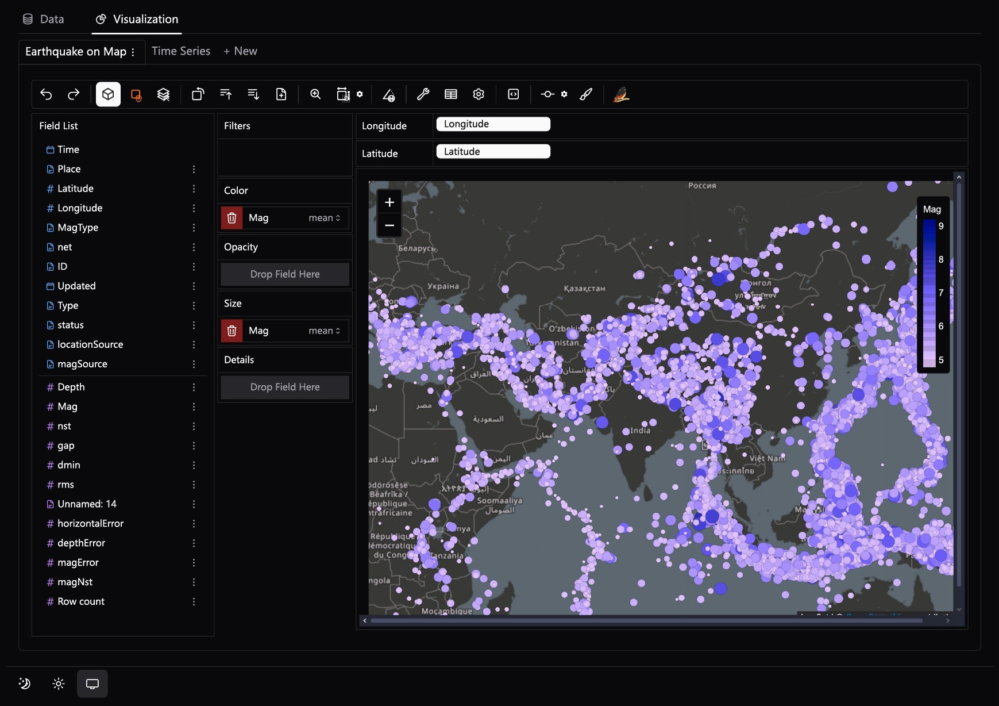
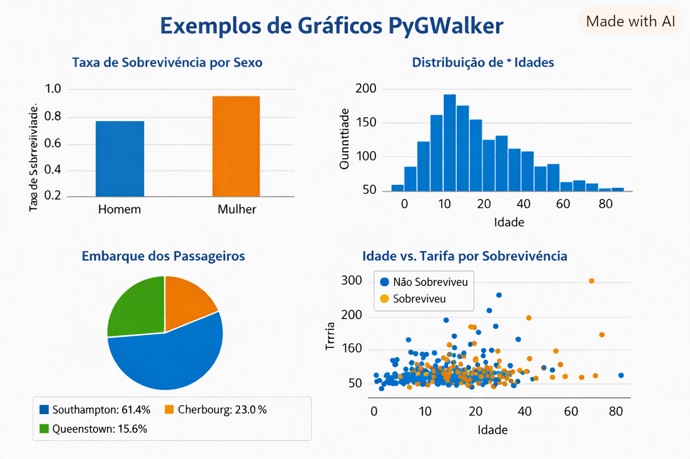

# 📖 Manual Ilustrado – PyGWalker

## 🎯 Objetivo

Este manual foi criado para orientar estudantes e usuários na exploração visual e interativa de dados utilizando o **PyGWalker**[cite: 8].  
Ele reúne orientações práticas, exemplos passo a passo e referências visuais integradas ao ecossistema do **Data Pipeline Didático**.

---

## 🚀 Passo 1 – Conectar aos Dados do Pipeline

1. Acesse a etapa **4. Visualização (Viz)** na barra lateral da aplicação.
2. Selecione a camada de dados que deseja inspecionar:
   - `01_raw`: dados brutos da ingestão.
   - `02_silver`: dados higienizados e sem nulos/duplicatas.
   - `03_gold`: dados enriquecidos com novas features e discretizações.
3. O canvas do PyGWalker será inicializado com os campos da camada escolhida organizados em 
    **Field List** (dimensões e medidas).

---

## 📊 Passo 2 – Construir Gráficos Interativos (Arrastar e Soltar)

### 🔹 Gráfico de Barras

- Arraste uma coluna categórica (ex.: `Sex`) para o eixo **X (Columns)**.  
- Arraste uma coluna numérica ou métrica (ex.: `Survived`) para o eixo **Y (Rows)**.  
- **Resultado:** Comparação visual direta da taxa de sobrevivência por gênero.

### 🔹 Histograma

- Arraste uma variável quantitativa contínua (ex.: `Age`) para o eixo **X**.  
- No menu de marcas (*Mark Type*), selecione **Bar** ou configure a agregação para contagem/faixas[cite: 8].  
- **Resultado:** Perfil de distribuição de frequências das idades dos passageiros.

### 🔹 Gráfico de Setores (Pizza)

- Arraste a coluna de categorias (ex.: `Embarked`) para o canal **Color** ou dimensões.  
- Selecione o tipo de marcação **Arc / Pie**.  
- **Resultado:** Proporção relativa de passageiros por porto de embarque.

### 🔹 Gráfico de Dispersão (Scatter Plot)

- Arraste `Age` para o eixo **X**.  
- Arraste `Fare` para o eixo **Y**.  
- Arraste `Survived` para o canal **Color**.  
- **Resultado:** Relação cruzada entre idade, tarifa paga e padrão de sobrevivência.

---

## 🖼️ Exemplos Visuais do Ambiente

### Interface de Exploração Analítica (Canvas PyGWalker)

**Legenda:**

- **Ambiente de Exploração Multidimensional** – Área de trabalho com os campos disponíveis (*Field List*), áreas de eixos (*Columns/Rows*), filtros e canais estéticos (*Color, Opacity, Size*) integrados ao Streamlit.

---

### Exemplos de Padrões e Tipos de Gráficos

**Legenda:**

1. **Taxa de Sobrevivência por Sexo** – Gráfico de barras comparando categorias.  
2. **Distribuição de Idades** – Histograma evidenciando faixas etárias.  
3. **Embarque dos Passageiros** – Proporções categóricas por local de embarque.  
4. **Idade vs. Tarifa por Sobrevivência** – Dispersão identificando agrupamentos e outliers.

---

## 🧮 Passo 3 – Agrupamentos e Agregações

- Clique na pílula do campo posicionado nos eixos para alterar a função matemática (ex.: `SUM`, `MEAN`, `COUNT`, `MEDIAN`).
- Exemplo prático: adicione `Pclass` no eixo X e selecione a média de `Survived` no eixo Y para verificar o gradiente de sobrevivência por classe socioeconômica[cite: 8].

---

## 🎛️ Passo 4 – Filtros e Detalhamento

- Arraste qualquer coluna para a caixa **Filters** para segmentar o público (ex.: restringir a análise apenas a passageiros menores de 18 anos).  
- Utilize o canal **Color** para cruzar dimensões adicionais sem aumentar a complexidade dos eixos.  
- Alterne o tipo de gráfico diretamente pelo seletor de marcas sem perder os campos já configurados.

---

## 📤 Passo 5 – Exportação de Resultados

- Exporte os gráficos gerados diretamente em formato de imagem (**PNG** ou **SVG**) usando os controles superiores do gráfico[cite: 8].  
- Alterne para a aba **Data** para copiar tabelas agregadas e exportar recortes específicos[cite: 4, 8].

---

## 💡 Boas Práticas Pedagógicas

- **Comparar Camadas:** Incentive os alunos a inspecionarem a camada `01_raw` e depois a camada `03_gold` no PyGWalker para que vejam o impacto prático dos dados sem ruídos e com as novas variáveis prontas.
- **Cores Conscientes:** Ao atribuir variáveis categóricas ao canal de cor, limite a categorias com pouca cardinalidade (evite colunas com dezenas de categorias únicas para não poluir o gráfico).
- **Validação de Hipóteses:** Use o canvas visual para confirmar visualmente as anomalias detectadas previamente no relatório de *Profiling*.

---

📘 **Autor:** Hilário Gouveia[cite: 8]  
🧩 **Ferramentas:** Python, Pandas, Streamlit, PyGWalker[cite: 8]  
📅 **Versão:** 1.0[cite: 8]