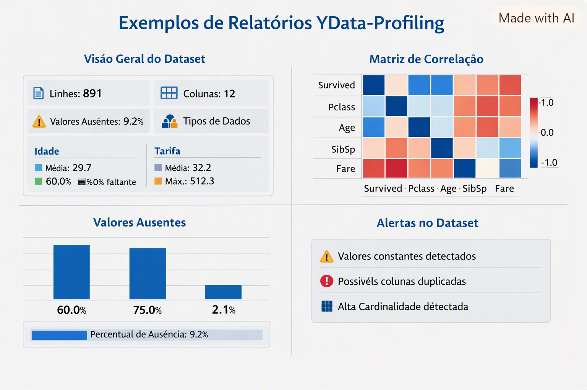

# 📖 Guia Prático: Análise Exploratória Automatizada com YData-Profiling

## 🎯 Objetivo

Apresentar de forma didática e acessível como interpretar e gerar relatórios completos de **Análise Exploratória de Dados (EDA)** utilizando o **YData-Profiling**, seja por meio do dashboard interativo ou diretamente via Python.

---

## 🧭 Como Usar no Aplicativo (Interface Gráfica)

1. **Carregar os Dados:** Na barra lateral da aplicação, envie seu arquivo CSV (ex.: `titanic.csv`).
2. **Acessar a Aba de Ingestão:** Na tela **1. Ingestão & Profiling (Bronze)**, clique na aba **📑 Diagnóstico de Qualidade (Profiling)**.
3. **Gerar o Relatório:** Marque a caixa de seleção para processar o diagnóstico estatístico completo sob demanda.
4. **Exportar:** Você pode inspecionar os gráficos interativos na tela ou salvar a página como arquivo HTML pelo próprio navegador.

---

## 💻 Como Gerar via Código Python (Script / Notebook)

Para alunos que desejam automatizar relatórios fora da interface:

```python
import pandas as pd
from ydata_profiling import ProfileReport

# 1. Carregar os dados brutos
df = pd.read_csv("titanic.csv")

# 2. Gerar o perfil diagnóstico (modo otimizado)
profile = ProfileReport(
    df, 
    title="Relatório de Qualidade - Dataset Titanic", 
    minimal=True
)

# 3. Exportar para arquivo HTML interativo
profile.to_file("relatorio_titanic.html")
```

---

## 🖼️ Seções e Anatomia do Relatório

O relatório gerado reúne as principais métricas de saúde dos dados em seis painéis principais:

| Seção | O que analisa | Pergunta respondida |
| --- | --- | --- |
| **Overview** | Resumo geral da tabela | Quantas linhas, colunas, tipos e % de nulos existem no total? |
| **Variables** | Estatísticas individuais por coluna | Qual é a distribuição, média, mediana, desvio padrão e zeros? |
| **Alertas (Warnings)** | Diagnóstico automático de problemas | Existem colunas com alta cardinalidade, constantes ou 100% nulas? |
| **Interactions** | Gráficos bi-variados de dispersão | Como duas variáveis numéricas interagem visualmente entre si? |
| **Correlations** | Matriz e mapa de calor (*heatmap*) | Quais variáveis numéricas têm forte correlação positiva ou negativa? |
| **Missing Values** | Matriz de ausência de dados | Onde estão concentrados os nulos e existe padrão na ausência? |
| **Sample** | Amostra dos registros | Como são as primeiras e últimas linhas da base na prática? |

---

## 🖼️ Exemplos Visuais do Relatório



**Legenda:**

1. **Visão Geral do Dataset** – resumo com número de linhas, colunas, tipos de dados e estatísticas básicas.  
2. **Matriz de Correlação** – heatmap mostrando relações entre variáveis (ex.: idade, tarifa, sobrevivência).  
3. **Valores Ausentes** – gráfico destacando colunas com dados faltantes e percentual de ausência.  
4. **Alertas Automáticos** – avisos sobre colunas duplicadas, valores constantes ou alta cardinalidade.  

---

## 💡 Dicas Didáticas para Sala de Aula

* **Atenção aos Alertas:** Antes de ir para a etapa de **Limpeza (Silver)**, olhe primeiro a aba **Warnings**. Ela é o "laudo médico" que indica exatamente onde aplicar preenchimento de nulos e remoção de duplicatas.
* **Performance em Datasets Grandes:** Em arquivos com mais de 20.000 linhas, use sempre o parâmetro `minimal=True` no Python para desativar cálculos de correlação complexos que tornam a geração lenta.
* **Decisões Baseadas em Evidências:** Compare a distribuição da variável antes da imputação para decidir com embasamento se deve usar a **mediana** (em distribuições assimétricas com outliers) ou a **média** (em distribuições normais/simétricas).
